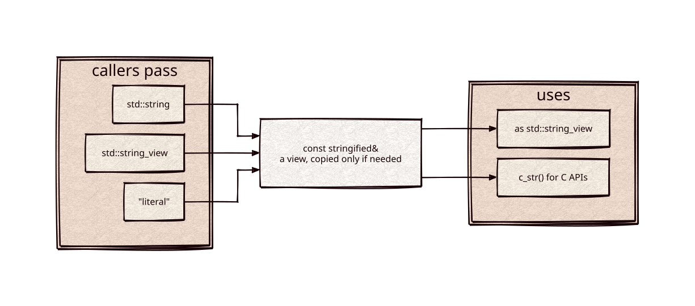

# stringified

[](https://github.com/Kronuz/stringified/actions/workflows/ci.yml)
[](LICENSE)


One parameter type for every kind of string in C++20: take a
`const stringified&`, callers pass a `std::string_view` (implicitly) or a
`std::string` (wrapped explicitly), and you get a view, plus a null-terminated `c_str()`
when a C API needs one. It copies only when termination requires it.



## ✨ Highlights

- **One signature** for views and strings: `std::string_view` converts implicitly;
  `std::string` takes an explicit `stringified(s)`.
- **No copy when possible.** `c_str()` points back into a whole `std::string`;
  it copies once only for a non-terminated slice.
- **Reads like a `string_view`**: `size()`, `data()`, iteration, `operator[]`, and
  an implicit conversion.
- **One header, no dependencies.**

## 📦 Installation

Requires a C++20 compiler; CMake 3.14 or newer for the CMake route. CI builds it
on Linux (x86_64, arm64), macOS (arm64, x86_64), and FreeBSD, plus ASan, UBSan,
and TSan builds.

```cmake
include(FetchContent)
FetchContent_Declare(stringified
  GIT_REPOSITORY https://github.com/Kronuz/stringified.git
  GIT_TAG        main)
FetchContent_MakeAvailable(stringified)

target_link_libraries(my_app PRIVATE stringified::stringified)
```

Or copy `stringified.hh` onto your include path.

## 🚀 Quick start

```cpp
#include "stringified.hh"

#include <cstdio>
#include <string>
#include <string_view>

void log_line(const stringified& s) {
	std::fputs(s.c_str(), stderr);   // null-terminated, copied only if needed
}

int main() {
	std::string owned = "from a std::string\n";
	log_line(stringified(owned));                          // explicit; no copy
	log_line(std::string_view("from a view\n"));           // implicit
	log_line(std::string_view("from a literal\n"));
}
```

## 🎯 When to use it

- ✅ Functions that pass strings on to C APIs (`open`, `getenv`, `syslog`) but
  should accept any string type.
- ❌ Owning storage: it is a parameter type, not a string class.

## 📚 Documentation

- [docs/API.md](docs/API.md): usage and the full interface.
- [ARCHITECTURE.md](ARCHITECTURE.md): when it copies, and why.
- [AGENTS.md](AGENTS.md): repository map and traps.

## 🛠️ Building and testing

```sh
cmake -B build && cmake --build build && ctest --test-dir build
```

## 🤝 Contributing

Issues and pull requests are welcome. Read [AGENTS.md](AGENTS.md) first. CI must
pass on every platform.

## 📄 License

MIT, Copyright (c) 2015-2018 Dubalu LLC. See [LICENSE](LICENSE). Extracted from
[Xapiand](https://github.com/Kronuz/Xapiand).
